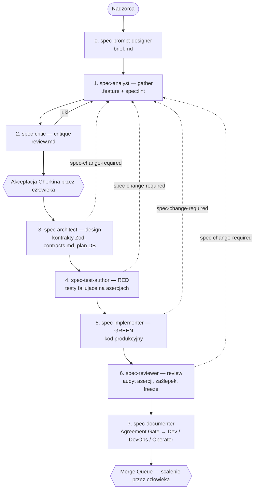

# Proces wytwórczy AI-first w projekcie Ultima PAM 4.0


## 1. Streszczenie

**PAM (Player Account Management, Ultima 4.0)** powstaje w modelu **agent-first**:

- Kod produkcyjny, testy, kontrakty i dokumentację wytwarzają wyspecjalizowani agenci AI.
- Ludzie definiują wymagania, projektują granice domen, zatwierdzają artefakty w punktach kontrolnych i scalają zmiany.

**Filary podejścia:**

1. **Spec-Driven Development (SDD).** Każda funkcja przechodzi 7 etapów: gather → critique → design → test (red) → implement (green) → review → document. Każdy etap ma dedykowanego agenta, dobrany model i wąskie uprawnienia do plików. Dla drobnych zmian istnieje ścieżka skrócona.
2. **Dokumentacja jako kod.** Wymagania zapisujemy po polsku w składni EARS, makiety w tekstowym Markdown-UI DSL, a specyfikacje wykonywalne w Gherkin. Wszystko jest wersjonowane w Git i powiązane identyfikatorami wymagań (`REQ-*`) oraz pytań decyzyjnych (`Q-*`).
3. **Architektura pod pracę z LLM.** Moduły są małe, domeny komunikują się przez porty, kontrakty opisują schematy Zod, a budżet kontekstu na sesję jest ograniczony.
4. **Wielowarstwowe bramki jakości.** Działają w procesie agentowym, lokalnie przed wypchnięciem zmian i w CI z Merge Queue.
5. **Hybrydowa automatyzacja nocna.** Deterministyczne skrypty wspierane przez LLM raportują stan repozytorium, wykrywają niestabilne testy i aktualizują gałęzie PR z automatycznym rollbackiem.
6. **Praca wielosesyjna.** Kilo Code z Agent Managerem pozwala prowadzić wiele równoległych strumieni na izolowanych Git Worktrees.

---

## 2. Skala (rząd wielkości)

| Obszar | Wartość |
|---|---|
| Okres rozwoju | ok. 3 miesiące (koniec czerwca – wrzesień 2026) |
| Zespół | koordynator + 3 nadzorców agentów |
| Aplikacje / pakiety | 6 aplikacji, 3 pakiety domenowe, 2 pakiety narzędziowe |
| Kod TypeScript | ok. 230 tys. linii |
| Kod produkcyjny | ok. 85 tys. linii w ponad 1 100 plikach (mediana ok. 40 linii na plik) |
| Kod testów | ok. 145 tys. linii (ok. 1,7 linii testu na linię produkcji), ponad 400 plików testowych, w tym ok. 140 specyfikacji feature E2E |
| Wymagania EARS | ok. 250 wymagań w 13 domenach |
| Pytania decyzyjne `Q-*` | ok. 320, wszystkie rozstrzygnięte i udokumentowane |
| Makiety UI | ok. 40 ekranów |
| Specyfikacje Gherkin | ok. 100 plików `.feature`, ok. 4 000 scenariuszy |
| Dokumentacja wynikowa | ok. 290 dokumentów (Dev / DevOps / Operator), ok. 200 diagramów PlantUML |
| Decyzje architektoniczne | 12 ADR |
| Baza danych | ok. 65 migracji, ok. 70 tabel |
| Konfiguracja agentowa | 9 agentów, 10 komend, 15 skilli, 3 pliki reguł stałych |
| CI | 8 workflowów GitHub Actions; główny check trwa ok. 4 minut, odsetek awarii poniżej 2% |
| Ślad procesu | ok. 940 wpisów etapowych dla ok. 100 funkcji |

---

## 3. Zespół i punkty kontroli człowieka

### 3.1. Role

| Rola | Kto | Odpowiedzialność |
|---|---|---|
| **Koordynator** | Andrzej Gładysz | Kierunek projektu, decyzje merytoryczne, integracje, aktywizacja interesariuszy |
| **Nadzorcy agentów** | Bartosz Bratuś, Szymon Targosz, Grzegorz Gancarczyk | Prowadzenie flow SDD, akceptacja artefaktów, weryfikacja na podglądach, scalanie; jedyne osoby z prawem zapisu wymagań do repozytorium |
| **Biznes / PO / PM** | Strona biznesowa NTP | Decyzje produktowe, rozstrzyganie `Q-*`, akceptacja wymagań |
| **Interesariusze** | BOK, Marketing, Bukmacherzy | Uwagi w HackMD, weryfikacja makiet, feedback z podglądów UI |
| **Agent nocny** | automat CI | Raporty, analiza stabilności testów, aktualizacja gałęzi PR |

Odpowiedzialność za każdy commit ponosi człowiek. W repozytorium nie stosujemy atrybucji AI (`Co-Authored-By`).

Nadzorcy nie przeglądają linia po linii kodu generowanego rutynowo. Zatwierdzają artefakty w punktach kontrolnych, zmiany DDL i PR-y przed scaleniem. W badanym okresie na ok. 100 PR przypadło ponad 200 recenzji.

### 3.2. Punkty kontroli (Human-in-the-Loop)

1. **Brief (etap 0).** Agent `spec-prompt-designer` prowadzi ustrukturyzowany wywiad z nadzorcą: proponuje domenę, aplikację docelową, moduł, zakres i wykluczenia. Człowiek zatwierdza brief.
2. **Tryb pracy.** Orkiestrator pyta, czy funkcja wynika z istniejących wymagań EARS, czy dotyczy nowego obszaru (`--new`).
3. **Akceptacja Gherkina.** Następuje po etapie krytyki i ewentualnych rewizjach. Pipeline zatrzymuje się na interaktywnym pytaniu i bez akceptacji żaden agent techniczny nie startuje.
4. **Migracje SQL.** Wygenerowany DDL jest prezentowany nadzorcy, a `db:migrate` uruchamia się tylko po jego zgodzie.
5. **Operacje destrukcyjne** na bazie i infrastrukturze wymagają jawnej autoryzacji.
6. **Scalenie.** Wykonuje je wyłącznie człowiek przez GitHub Merge Queue, po zielonych checkach. Automaty nie zmieniają `main`.
7. **Zmiany wymagań od biznesu** trafiają wyłącznie przez PR z etykietą `needs-po-review`.
8. **Ocena produktu.** Zespół i interesariusze sprawdzają UI na Netlify Preview (dane fikcyjne, mocki MSW).

---

## 4. Warstwy specyfikacji

| Warstwa | Lokalizacja | Odbiorca | Rola |
|---|---|---|---|
| Archiwum legacy | `spec/legacy/` | zespół | Tylko do odczytu. Materiał historyczny, nie jest źródłem prawdy. |
| Wymagania EARS | `spec/domains/<domena>/requirements.md` | biznes, PO, zespół | **Źródło prawdy dla reguł biznesowych.** Język polski, bez żargonu technicznego. |
| Makiety UI | `spec/domains/<domena>/ui/` | biznes, frontend | Źródło prawdy wyłącznie dla układu ekranu |
| Macierz śledzenia | `spec/domains/<domena>/traceability.md` | tylko zespół | Mapowanie `REQ-*` na reguły legacy |
| Specyfikacje wykonywalne | `spec/features/<domena>/*.feature` | zespół | **Źródło prawdy dla zachowania.** Gherkin z tagami `@req:<domena>#REQ-*`, zamrożony po akceptacji |
| Dokumentacja wynikowa | `docs/dev`, `docs/devops`, `docs/operator` | Dev, DevOps, BOK | Stan zbudowany (as-built), diagramy PlantUML |
| Zakres | `spec/scope.md` | wszyscy | 10 decyzji nadrzędnych (m.in. single-tenant, Keycloak, rynek PL, Tpay/P24/PayU/BLIK) |

**Wymagania EARS.** Każde wymaganie ma:
- identyfikator,
- priorytet MoSCoW,
- status akceptacji,
- zdanie EARS,
- uzasadnienie biznesowe,
- kryteria akceptacji,
- powiązanie z makietą.

Rozkład wzorców EARS: ok. ¾ zdarzeniowe („Gdy…”), ok. 10% wszechobecne, ok. 10% niepożądane lub opcjonalne („Jeżeli…”), kilka procent stanowe („Dopóki…”). Priorytety: ok. 70% Must, ok. 25% Should, ok. 5% Could.

**Makiety (Markdown-UI DSL)** opisują hierarchię i kontrolki ekranu w 6 obowiązkowych stanach: domyślny, pusty, ładowanie, błąd, brak uprawnień (403), dialog. Model czyta je jako tekst, więc na etapie analizy nie są potrzebne narzędzia graficzne.

---

## 5. Flow SDD — agenci i etapy

### 5.1. Przebieg



**Mechanika:**

- **Orkiestrator** (`spec-orchestrator`) deleguje etapy synchronicznie. Każdy subagent startuje w świeżym kontekście i dostaje brief oraz artefakty wejściowe.
- **Stan procesu jest w repozytorium, nie w czacie.** Każdy etap dopisuje wpis `[STATUS] <domena>/<funkcja> <etap> done|blocked: <powód>` do dziennika append-only. Orkiestrator ocenia postęp wyłącznie na jego podstawie.
- **Pętla rewizji.** Każdy etap techniczny może zgłosić `blocked: spec-change-required`. Praca wraca wtedy do analityka (`--revise`) i ponownie do krytyka. Zmiana specyfikacji zawsze cofa flow przed etap architektury.
- **Circuit breaker.** Pętle rewizji i implementacji mają limit 3 prób. Po jego wyczerpaniu flow zatrzymuje się i trafia do człowieka z raportem blokady.
- **Jeden etap to jeden commit.** Dzięki temu historia każdej funkcji jest czytelna i audytowalna.

### 5.2. Agenci, modele i uprawnienia

Zasada separacji: **agent, który koduje, nie recenzuje, a agent, który recenzuje, nie koduje.** Krytyk, implementer i recenzent korzystają z modeli trzech różnych dostawców. Wszystkie modele są wywoływane przez Kilo Gateway i przypięte do wersji.

| Agent | Etap | Model (obecnie) | Rozumowanie / limit kroków | Uprawnienia do plików | Zadanie |
|---|---|---|---|---|---|
| `spec-orchestrator` | całość | DeepSeek v4 Flash 0731 | high / 100 | tylko pliki stanu i briefu; deny na `.feature` i kod | stan, delegowanie, bramki ludzkie, pętle rewizji |
| `spec-prompt-designer` | 0 | Grok 4.6 | medium / 50 | tylko prompt i `brief.md` | wywiad, dekompozycja zakresu, wykluczenia, pytania otwarte |
| `spec-analyst` | 1 | GLM 5.3 | high / 50 | **jedyny z zapisem do `.feature`**; wymagania = ask | EARS → Gherkin, tagi `@req`, lint do skutku |
| `spec-critic` | 2 | Gemini 3.8 Flash | high / 50 | tylko `review.md` i log; deny na `.feature` | kompletność, przypadki brzegowe, kontrakty asynchroniczne i trwałości |
| `spec-architect` | 3 | DeepSeek v4 Pro 0813 | high / 50 | `apps/**`, `packages/**`, `contracts.md` | cienkie kontrakty, porty DI, schematy Zod, plan zmian DB |
| `spec-test-author` | 4 | GLM 5.3 Flash | high / 100 | tylko testy i mocki | testy E2E/unit w Jest, failujące wyłącznie na asercjach |
| `spec-implementer` | 5 | Grok 4.6 | high / 50 | `apps/**`, `packages/**`; deny na `.feature` | pełna implementacja do zielonych testów, bez zaślepek |
| `spec-reviewer` | 6 | DeepSeek v4 Pro 0813 | high / 50 | tylko raporty review i coverage; shell read-only | audyt asercji, zaślepek, zamrożenia specyfikacji |
| `spec-documenter` | 7 | DeepSeek v4 Flash 0731 | high / 80 | tylko `docs/**` i raport rozbieżności | Agreement Gate, dokumentacja w trzech wersjach |

Architekt i recenzent korzystają dziś z tego samego modelu. Traktujemy to jako znany kompromis: recenzent ocenia implementację innego dostawcy (xAI), a nie własną. Pełniejszą dywersyfikację rozważamy w roadmapie.

### 5.3. Bramki wewnątrz flow

| Etap | Warunek przejścia |
|---|---|
| gather | `yarn spec:lint` = 0. Każda reguła z briefu ma scenariusz. `@todo` tylko dla udokumentowanych braków decyzyjnych. |
| critique | Tagi `@req` rozwiązują się do wymagań. Brak kontraktu dla operacji asynchronicznej lub trwałości blokuje flow (`Missing boundary contract`). |
| design | Status `Approved for architecture`, manifest `contracts.md` (scenariusz × aplikacja), lint kontraktów, pełny `check-types`. |
| test (red) | Testy się kompilują i failują wyłącznie na asercjach. Nie mogą failować przez `TypeError`, brak modułu czy nieistniejącą metodę. |
| implement (green) | `test:e2e`, `lint`, `check-types` i `build` przechodzą w dotkniętych aplikacjach. Zakaz guardów always-pass, pustych implementacji i hardkodowanych użytkowników. |
| review | `spec:lint --strict`; diff testów pod kątem usuniętych asercji; kontrola, czy `.feature` zmieniał tylko analityk; skan tokenów TODO/FIXME, no-opów i sztucznych mocków. |
| document | Jeśli kod rozjechał się z zatwierdzonym Gherkinem, dokumentacja nie jest publikowana i powstaje raport `documentation-drift`. |

### 5.4. Co pokazuje ślad procesu

- **Ok. 940 wpisów etapowych na ok. 100 funkcji**, czyli średnio ok. 9 wpisów na funkcję przy 7 etapach. Różnicę tworzą powtórzenia etapów w pętlach rewizji i ponownych próbach implementacji.
- **Ok. 70 rewizji specyfikacji** (`gathered(revised)`) potwierdza, że pętla analityk ↔ krytyk ↔ etapy techniczne działa w praktyce.
- **Ok. 65 twardych blokad**, w tym blisko 30 cofnięć `spec-change-required` z etapów technicznych do analityka. Późniejsze etapy zatrzymują pracę, zamiast przepuszczać niejasności.
- Funkcje z pełnego cyklu mają komplet artefaktów: `review`, `contracts`, `impl-plan`, `code-review`, `coverage`. Funkcje ze ścieżki skróconej mają zestaw zredukowany.

---

## 6. Architektura pod pracę z agentami

### 6.1. Monorepo (Turborepo + Yarn Berry)

| Workspace | Rola |
|---|---|
| `apps/pam-api` | Backend HTTP: NestJS 11, BetterAuth + Keycloak, Drizzle; ok. 15 klastrów domenowych |
| `apps/pam-ui` | Backoffice: React 19, Vite 8, TanStack Router/Query/Table, shadcn/ui, Tailwind v4 |
| `apps/pam-worker` | Worker bez HTTP: zadania `@Cron`, outbox relay, silnik segmentacji. API nie ma cronów. |
| `apps/pam-event-bridge` | Most zdarzeń RabbitMQ → Kafka (zewnętrzne archiwum) |
| `apps/pam-notifier` | Konsument kolejki powiadomień |
| `apps/migrator` | Kontener migracji DDL w trybie fail-closed (`lock_timeout = 5s`) |
| `packages/contracts` | Źródło prawdy dla typów: schematy Zod, `z.infer`, fixture'y `MOCK_*` |
| `packages/db` | Schemat Drizzle, migracje, seedy, linter bezpieczeństwa DDL |
| `packages/backend-shared` | Wspólne prymitywy backendowe: DB, outbox, zdarzenia, health |

### 6.2. Inżynieria kontekstu

- **Budżet ≤ 170 tys. tokenów na sesję.** Agenci czytają kod punktowo (read z zakresem, grep, glob, wyszukiwanie semantyczne) zamiast ładować całe repozytorium.
- **Warstwowe instrukcje.** `AGENTS.md` i 3 krótkie pliki reguł stałych (core, backend, frontend) są ładowane zawsze. 15 skilli jest doczytywanych na żądanie:
  - bramka startowa `task-preflight`,
  - skille budujące kontrakty, moduły backendowe, funkcje frontendowe, migracje i uprawnienia,
  - konwencje backend i frontend,
  - skille testowe,
  - skille do wymagań i makiet oraz ich przeglądu przed publikacją,
  - skill do formatu commitów.
- **Atomowość zadań.** Jedno zadanie to albo schemat DB z migracją, albo jeden zasób API (kontroler, serwis, testy), albo jedna powierzchnia UI. Mega-PR-y są zabronione.
- **Małe pliki.** Mediana ok. 40 linii, 90. percentyl ok. 165 linii, powyżej 500 linii jest ok. 1% plików.

### 6.3. Granice i niezmienniki

- **Brak zapytań SQL między klastrami.** Komunikacja idzie przez ok. 40 portów domenowych wstrzykiwanych przez DI (np. bramki wypłat, blokada logowania przy wykluczeniu, sesje gracza).
- **ESLint `no-restricted-imports`** blokuje importy między aplikacjami.
- **12 ADR:** m.in. PostgreSQL jako jedyny system of record, Outbox Pattern, idempotencja operacji finansowych, Value Object `Money`.
- **Uprawnienia wymuszane typami.** Klucze RBAC są typowane w kontraktach. Seedy i mocki używają `Record<PermissionKey, …>`, więc niezarejestrowane uprawnienie nie przejdzie kompilacji.

---

## 7. Modele językowe — dobór i ewolucja

### 7.1. Zasady doboru

- **Klasa szybka / tania** obsługuje orkiestrację, dokumentację, testy i raporty nocne.
- **Klasa analityczna** obsługuje wymagania, Gherkin i krytykę.
- **Klasa najmocniejsza** obsługuje architekturę, implementację, review i rozwiązywanie konfliktów.
- **Hybryda deterministyczna.** Mechanikę operacyjną (Git, API, parsowanie) wykonują skrypty TypeScript lub Python. LLM dostaje wyłącznie wąskie zadanie semantyczne na minimalnym payloadzie.
- **Wersje przypięte do daty wydania** (np. `0731`, `0813`). Zmiana modelu jest świadomą decyzją widoczną w historii Git.

### 7.2. Historia zmian modeli per rola

| Data | Zmiana | Powód |
|---|---|---|
| 24.06 | Pierwsza wersja agentów SDD | start procesu |
| 29.06 | Modele domyślne: GLM 5.2 (analiza), DeepSeek v4 Pro / Flash (pozostałe role) | ujednolicenie bazowej konfiguracji |
| 03.07 | Standaryzacja dostępu przez Kilo Gateway; próba Gemini 3.1 Flash Lite | jeden kanał dostępu, test tańszego modelu |
| 15.07 | Włączenie `spec-documenter` do flow | dokumentacja jako etap procesu |
| 06.08 | Przypięcie DeepSeek v4 Flash 0731; wycofanie Gemini Flash Lite | stabilność wyników, niewystarczająca jakość wersji Lite |
| 20.08 | Architekt i recenzent → DeepSeek v4 Pro 0813; implementer: porównanie GPT-5.6 Luna i Grok 4.6 | wyższa jakość analizy typów i review; wybór modelu do kodu |
| 04.09 | Analityk → GLM 5.3; krytyk → Gemini 3.8 Flash; autor testów → GLM 5.3 Flash; implementer → Grok 4.6 (rezygnacja z Luny); orkiestrator i dokumentalista → rozumowanie high | obserwowana jakość na realnych funkcjach |

Konfiguracja modeli zmieniała się mniej więcej co 2–3 tygodnie, zawsze w odpowiedzi na obserwowane problemy jakościowe albo kosztowe.

---

## 8. Narzędzia i środowisko

- **Kilo Code** (wtyczka VS Code i CLI). Konfiguracja agentów, komend, skilli i reguł leży w `.kilo/`. Zgodność z OpenCode zapewniają symlinki.
- **Agent Manager + Git Worktrees.** Każda sesja pracuje na własnym drzewie roboczym i gałęzi. W szczycie równolegle działa ok. 10 worktree. Skrypt inicjalizujący kopiuje lokalną konfigurację, instaluje zależności, buduje pakiety i weryfikuje środowisko; ma blokadę przed uruchomieniem w katalogu głównym. Efekt: jeden inżynier prowadzi równolegle np. dwie funkcje biznesowe i poprawkę DevOps bez przełączania gałęzi.
- **Wyszukiwanie semantyczne** działa na lokalnym indeksie embeddingów (`mistral-embed`).
- **MCP Atlassian** daje agentom dostęp do Jira i Confluence. Kontener jest efemeryczny, z obrazem przypiętym do sha256.
- **GitHub Enterprise Cloud NTP** z Merge Queue i 8 workflowami Actions.
- **HackMD, Netlify Preview + MSW, Feedbucket** obsługują pętlę z interesariuszami (rozdz. 10).

---

## 9. Bramki jakości w CI i lokalnie

| Warstwa | Co sprawdza |
|---|---|
| **Lokalnie: `/pre-push-verify`** | Pełny łańcuch: install, lint, spec:lint, check-types, testy, pokrycie, build, E2E. Agent naprawia błędy i ponawia do skutku. |
| **`quality.yml`** (wymagany w Merge Queue) | `yarn install --immutable`, ESLint + linter DDL, pełny `check-types`, testy jednostkowe i integracyjne na PGlite. Mediana ok. 4 min. |
| **`spec-review.yml`** | `spec:lint --strict` dla zmienionych `.feature` i E2E dla dotkniętych klastrów (`turbo --filter`) |
| **`netlify-preview.yml`** | Podgląd UI z MSW i widgetem Feedbucket dla każdego PR z `pam-ui` |

**Linter specyfikacji i kontraktów (`spec:lint`) sprawdza:**
- składnię Gherkina,
- czy każdy scenariusz ma tag `@req` rozwiązujący się do wymagania,
- czy tabele `Examples` nie są puste,
- czy nazwy scenariuszy się nie powtarzają,
- czy istnieje manifest kontraktów,
- czy deklarowane symbole są faktycznie eksportowane (weryfikacja kompilatorem TypeScript).

**Bezpieczeństwo DDL (linter migracji):**
- Indeksy na istniejących tabelach wolno tworzyć tylko z `CONCURRENTLY`.
- Na tabelach księgi finansowej obowiązuje zakaz DDL blokujących lub przepisujących tabelę.
- `CONCURRENTLY` nie może być w jednej transakcji z innym DDL.
- Runner migracji działa fail-closed.
- Audytowane narzędzie replay DLQ pozwala tylko na list, inspect i replay (bez purge). Wymaga podania operatora i powodu, a każde użycie trafia do tabeli audytowej.

**Rozkład testów (w przybliżeniu):**

| Aplikacja | Pliki testowe | W tym E2E |
|---|---|---|
| pam-api | ok. 140 | ok. 75 |
| pam-ui | ok. 140 | ok. 40 |
| pam-worker | ok. 25 | ok. 20 |
| pam-event-bridge | ok. 25 | kilka |
| packages (contracts, db) | ok. 70 | — |
| pozostałe | kilkanaście | — |

---

## 10. Pętla z interesariuszami

```
Repozytorium (źródło prawdy)
   │ publikacja                         ▲ import zwrotny (PR, needs-po-review)
   ▼                                    │
 HackMD Book  ◄──── komentarze, sugestie, decyzje Q-* ────►  Biznes / PO

 PR z pam-ui ──► Netlify Preview (MSW) ──► Feedbucket ──► GHE Issues ──► triaż nadzorców
                                                                          ├─ usterka UI → poprawka
                                                                          └─ zmiana reguły → EARS → /spec-gather --revise
```

- **HackMD.** Do HackMD publikujemy ok. 45 notatek: wymagania, makiety, spis treści i przewodnik dla interesariusza. Macierz śledzenia, pliki `.feature` i archiwum legacy są technicznie zablokowane przed publikacją.
- **Import zwrotny.** W dni robocze o 07:00 UTC workflow pobiera edycje i otwiera PR z etykietami `stakeholder-feedback` i `needs-po-review`. Decyzje z warsztatów zapisujemy z datą i autorem.
- **Netlify Preview.** Każdy PR z UI ma własny podgląd działający bez backendu, na mockach MSW zgodnych z kontraktami.
- **Feedbucket.** Uwaga przypięta do elementu ekranu staje się issue w GHE. Webhook weryfikuje podpis.
- **Triaż.** Usterki wizualne trafiają wprost do kodu. Zmiany reguł idą najpierw przez EARS, potem przez rewizję Gherkina i pełny cykl SDD.

---

## 11. Automatyzacja nocna (nightly agent)

### 11.1. Skąd potrzeba

Przeanalizowaliśmy ok. 90 dni historii (ok. 100 PR, ponad 200 recenzji):
- W oknie nocnym i w weekendy aktywność zespołu jest praktycznie zerowa.
- Ok. 70% PR wymagało ręcznego rebase'u, średnio ponad 3 razy na PR. To zabierało nadzorcom czas w ciągu dnia.

### 11.2. Przebieg

```
02:00 UTC  Okno raportowe  (GLM 5.3 Flash, temp = 0, ≤ 1,5 tys. tokenów odpowiedzi)
  ├─ raport checków z poprzedniego dnia: twarde błędy vs testy niestabilne (flaky)
  ├─ gałęzie nieaktywne > 14 dni
  └─ stan rebase i gotowość PR

03:00 UTC  Okno aktywnego rebase  (Qwen 3.8 Max)
  1. otwarte PR (bez draftów, Merge Queue, dependabota)
  2. próbny rebase na origin/main w osobnym worktree
  3. konflikt prosty (≤ 3 pliki, ≤ 30 linii, ≤ 200 KB na plik)
       → LLM dostaje tylko skonfliktowane fragmenty jako JSON → decyzja resolve / abort
     konflikt złożony lub plik wykluczony → abort z uzasadnieniem
  4. push przez GitHub App z --force-with-lease (limit 10 PR na noc)
  5. oczekiwanie na check CI (do 25 min):
       zielony  → gałąź zostaje, komentarz w PR
       czerwony → automatyczny rollback do poprzedniego SHA + raport w PR
  6. maskowanie sekretów w logach
```

### 11.3. Zabezpieczenia

- **Model nie steruje Gitem.** Całą mechanikę wykonuje skrypt Pythona z własnymi testami jednostkowymi. LLM tylko przetwarza tekst w JSON.
- **Lista wykluczeń:** `.github/**`, migracje SQL, lockfile'e, `.env*`, klucze i certyfikaty.
- **Walidacja odpowiedzi.** Odpowiedź modelu jest odrzucana, jeśli zawiera znaczniki konfliktu albo nie obejmuje wszystkich spornych plików.
- **Rollback.** Każda zmiana przechodzi pełny check jakości. Jeśli go nie przejdzie, gałąź wraca do stanu sprzed zmiany.
- **Automat nigdy nie dotyka `main`.**

---

## 12. Bezpieczeństwo i ochrona IP

1. **Repozytorium** jest w dedykowanej instancji GitHub Enterprise Cloud NOVOMATIC (organizacja NTP) z korporacyjnym SSO. Pakiety i obrazy pochodzą z wewnętrznego rejestru Nexus.
2. **Jeden kanał do modeli.** Cały ruch agentowy przechodzi przez Kilo Gateway. Klucze CI są w GitHub Actions Secrets, a logi automatów są maskowane.
3. **Warunki przetwarzania danych** (no-training, retencja, region) weryfikujemy dla każdego dostawcy. Formalny rejestr dostawców jest częścią polityki AI z roadmapy.
4. **Brak danych produkcyjnych i osobowych w promptach.** Atomowe zadania ograniczają payload do pojedynczych modułów. Makiety, podglądy i testy (PGlite, `MOCK_*`) używają wyłącznie danych fikcyjnych.
5. **Separacja informacji wewnętrznych.** Traceability, `.feature` i legacy są filtrowane przy publikacji do HackMD. Przewodnik dla interesariuszy zabrania wpisywania haseł i danych osobowych.
6. **Higiena sekretów:**
   - `.gitignore` blokuje `.env*`, katalogi sekretów i certyfikaty,
   - reguła bazowa agentów zakazuje commitowania i logowania sekretów,
   - kontenery narzędziowe są efemeryczne.
7. **Łańcuch dostaw.** Wszędzie działa `yarn install --immutable`, akcje GitHub są przypięte do SHA, a obraz MCP do sha256. Przypinanie obrazów bazowych do digestów jest w toku.

---

## 13. Roadmapa

| Obszar | Działanie | Status |
|---|---|---|
| **Bramka scalania** | Build i `test:e2e --affected` jako wymagany check w Merge Queue; progi pokrycia | planowane |
| **Uczciwość testów** | Blokada plików testów po etapie RED (każda zmiana wymaga jawnej akceptacji), zakaz edycji testów i `.feature` w pętlach naprawczych, testy mutacyjne dla klastrów finansowych | planowane |
| **Kontrola wg ryzyka** | CODEOWNERS i obowiązkowy przegląd ludzki dla wallet, payments, txn-lifecycle, RG, auth, RBAC; sformalizowane kryteria ścieżki skróconej | planowane |
| **Skanowanie bezpieczeństwa** | `npm audit`, skan workflowów pod kątem nieprzypiętych akcji, gitleaks, Dependabot/Renovate; SAST | w toku (audyt nocny przygotowany) |
| **Kontenery i K8s** | Użytkownicy nie-root, digesty obrazów, `securityContext`, `NetworkPolicy`, własne runnery ARC | planowane |
| **Stacje robocze** | Tokeny MCP wyłącznie w zmiennych środowiskowych; zawężenie uprawnień `bash`/`edit` w Kilo do list ścieżek | planowane |
| **Treści zewnętrzne** | Traktowanie treści z HackMD, Feedbucket i Jira jako niezaufanych na wejściu do agentów z prawem zapisu | planowane |
| **Polityka AI** | Wiążący dokument: dopuszczone modele i dostawcy, klasyfikacja danych, retencja na bramie; uzgodnienie ze standardami Grupy | planowane |
| **Decyzje biznesowe** | Właściciel i termin dla każdego `Q-*`, domyślne założenie z datą wygaśnięcia, zbieranie pytań dla całej domeny przed startem prac | w toku |
| **Śledzenie Gherkin ↔ EARS** | Zastąpienie roboczych tagów `@req:new#…` kanonicznymi, redukcja `@todo`, ostrzeżenie o zmianie wymagania po zatwierdzeniu funkcji | w toku |
| **Środowisko zintegrowane** | Nocne testy pełnego środowiska, testy wydajnościowe, testy UI w prawdziwej przeglądarce | planowane |
| **Metryki przepływu** | Czas i koszt tokenów per etap i per funkcja, liczba prób, zadziałania circuit breakera, defekty po scaleniu; skuteczność agenta nocnego | planowane |
| **Szybkość flow** | Równoległy RED/GREEN dla backendu i frontendu po kontraktach, dokumentacja poza ścieżką krytyczną, deterministyczne audyty review w CI | planowane |
| **Utrzymanie wiedzy** | Konsolidacja specyfikacji i dokumentacji na poziomie domen, zestaw zadań wzorcowych do oceny modeli przed ich zmianą | planowane |

---

## 14. Wnioski z pierwszego kwartału

- **Specyfikacja zwraca się wielokrotnie.** Blisko 30 cofnięć z etapów technicznych do analityka to problemy wyłapane przed kodem, a nie po wdrożeniu.
- **Ograniczeniem są decyzje, nie kod.** Agenci piszą szybko. Tempo wyznaczają rozstrzygnięcia `Q-*` i przepustowość akceptacji ludzkiej, dlatego tam kierujemy kolejne usprawnienia.
- **Twarde reguły wygrywają z instrukcjami.** Tam, gdzie się da, zamieniamy zasady z promptów na uprawnienia i checki CI: freeze `.feature` przez uprawnienia, RBAC przez kompilator, DDL przez linter.
- **Hybryda „skrypt + LLM” działa.** Agent nocny pokazuje, że deterministyczna mechanika z wąskim zadaniem dla modelu jest tańsza i bezpieczniejsza niż pełna autonomia modelu.
- **Model dobieramy do roli.** Kilka rotacji w ciągu kwartału pokazało, że różne role potrzebują różnych modeli, a przypięte wersje ułatwiają porównanie.

---
