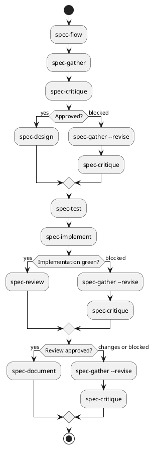

# Ultima — PAM

**PAM** (Player Account Management) — a backoffice system for managing players in the Novomatic SB ecosystem, built as part of the Ultima platform.

Core features: player registration and KYC verification, bonus management, player wallet with deposit/withdrawal transactions, role-based admin access (admin / superadmin), and player segmentation (VIP tiers).

## Stack

| Layer | Technology |
|---|---|
| Backend | NestJS 11 (monolith) |
| Auth | BetterAuth + Keycloak (OIDC) |
| Frontend | React 19 + Vite |
| Styling | Tailwind v4 + shadcn/ui |
| Database | PostgreSQL + Drizzle ORM |
| Package manager | Yarn v4 (Berry) |
| Monorepo | Turborepo |

## Prerequisites

- Node.js >= 22
- Docker
- Access to Novomatic Nexus (`docker login nexus.novomatic-tech.com`)

## Setup

```bash
# Required once: Keycloak image is hosted on Novomatic Nexus
docker login nexus.novomatic-tech.com

# Start infrastructure (idempotent — safe to run anytime)
bash scripts/bootstrap.sh

# Start apps
yarn dev               # pam-api (:3000) + pam-ui (:5000) via Turbo
```

Bootstrap installs dependencies (if needed), creates the Docker network, and starts PostgreSQL, admin Keycloak, and player Keycloak. You can also start infrastructure services individually:

```bash
yarn compose:db            # PostgreSQL
yarn compose:kc            # Keycloak (admin/backoffice)
yarn compose:kc:player     # Keycloak (players)
```

## Local services

| Service | URL | Credentials |
|---|---|---|
| pam-ui | http://localhost:5000 | — |
| pam-api | http://localhost:3000 | — |
| Keycloak admin | http://localhost:8180 | admin / admin |
| Keycloak players | http://localhost:8181 | admin / admin |
| PostgreSQL | localhost:5432 | pam / pam |

## Local Kubernetes deployment

For a full local k8s deployment of the PAM stack (k3d + Helm), see
[docs/devops/platform/local-k8s-deploy.md](docs/devops/platform/local-k8s-deploy.md).
One-shot deploy:

```bash
bash scripts/k8s-deploy.sh   # requires k3d, helm, kubectl, docker + Nexus login
```

Teardown: `k3d cluster delete pam`.

## Common commands

```bash
# Development
yarn dev                             # start all apps
yarn dev:fresh                       # clean generated artifacts, rebuild everything, then start all apps
yarn dev --filter pam-api            # start only backend
yarn dev --filter pam-ui             # start only frontend

# Build & quality
yarn build                           # build all
yarn build:fresh                     # clean + build all
yarn check-types                     # TypeScript across all packages
yarn lint                            # lint all
yarn lint:fix                        # lint + autofix
yarn test                            # run tests
yarn test:cov                        # tests with coverage report

# Infrastructure
yarn compose:db                      # start PostgreSQL
yarn compose:kc                      # start Keycloak (admin)
yarn compose:kc:player               # start Keycloak (players)
yarn compose:all                     # start everything
yarn compose:all:down                # stop everything
```

## Workspace commands

```bash
yarn workspace pam-api add <package>   # add dep to backend
yarn workspace pam-ui add <package>    # add dep to frontend
yarn add -W -D <package>               # add to monorepo root
```

## Git hooks

Husky runs automatically after `yarn install` (`prepare` script).

| Hook | Runs | What |
|---|---|---|
| pre-commit | on every commit | `yarn precommit` (lint:fix + check-types + test) |
| commit-msg | on every commit | prepends Jira key from branch name |

To skip hooks when needed (e.g. WIP push to draft PR):
```bash
git commit --no-verify
git push --no-verify
```

## Architecture and conventions
See [AGENTS.md](./AGENTS.md).

## Spec-Driven Development (SDD) Pipeline

The project uses an agentic pipeline to transform requirements into production code using a TDD (Red-Green-Refactor) approach. The flow is managed by the `spec-orchestrator`. Start the whole workflow by running 

```
/spec-flow <Your-Prompt>
```

**Optional stage 0 — `/spec-prompt <rough idea>`**: not part of the automated `/spec-flow` chain, but useful before it. The `spec-prompt-designer` interactively turns a rough idea into a structured, paste-ready prompt (domain & placement, scope in/out, data model guidance, open questions) and writes it to `spec-flow-prompt-<feature-slug>.md`, which you then paste as `/spec-flow`'s argument. A well-structured prompt matters even after gather is fixed to prioritize it (below) — it's where scope-out decisions get made explicitly, before gather can drift toward legacy. It also writes `spec/features/<root-slug>.brief.md` directly — the durable record described below — so that record exists reliably as this agent's primary output rather than as an easily-skipped side-effect of the orchestrator's own workflow.

### Pipeline Stages

1.  **Gather (`/spec-gather`)**: The `spec-analyst` transforms requirements into executable Gherkin `.feature` files, using the originating `/spec-flow` prompt as the primary source and `spec/legacy/<domain>.md` (when a counterpart exists) as corroborating evidence for `BR-n`/`UC-n` ids — not the other way around. Concrete rules the prompt states outright become real scenarios even where legacy is silent; anything the prompt explicitly excludes is recorded, not silently included just because legacy covers it. `/spec-gather --revise` is the only other variant, used when a downstream stage blocks on `spec-change-required` or the human requests a correction.
    - **Human Role**: Critical. The human provides the initial prompt (ideally via `/spec-prompt` above) and clarifies ambiguities. Because `.feature` files are frozen after this stage, the human must validate that the Gherkin accurately represents the intended business behavior before proceeding. The orchestrator pauses for this confirmation gate after every gather (first pass or `--revise`).
2.  **Critique (`/spec-critique`)**: The `spec-critic` reviews the feature specs for correctness, completeness, and requirement coverage. It ensures no contradictions with legacy docs and identifies missing boundary contracts.
3.  **Design (`/spec-design`)**: The `spec-architect` decides code placement across the monorepo, defines thin production contracts (interfaces/DTOs) in the host apps, and outlines DB schema changes.
4.  **Test (`/spec-test`)**: The `spec-test-author` implements failing plain Jest e2e tests (Red phase) — one test per Gherkin scenario, with no Cucumber/step-definition binding. These tests drive real app boundaries (e.g., UI $\to$ API $\to$ DB) to ensure the architecture is viable.
5.  **Implement (`/spec-implement`)**: The `spec-implementer` fills the architect's contracts with real logic until all tests pass (Green phase), completing the TDD loop.
6.  **Review (`/spec-review`)**: Final verification of the implementation against the original spec and a check for cross-app coverage.
7.  **Document (`/spec-document`)**: The `spec-documenter` reconciles the current implementation with the approved feature artifacts and publishes separate audience documents under `docs/dev/`, `docs/devops/`, and `docs/operator/`. The Dev document includes current database and API contract schemas. All diagrams in these documents use PlantUML. Material drift blocks publication and produces a feature-scoped documentation drift report.

### Communication & Orchestration

Agents communicate asynchronously through **Artifacts**, a **Brief**, and a **Status Log** — Kilo primary/subagents run in isolated contexts, so nothing survives between stage invocations except what's written to these files:
- **Brief**: `spec/features/<root-slug>.brief.md` is the durable record of the verbatim originating prompt (append-only, one entry per distinct prompt). `spec-prompt-designer` writes it directly as its primary output when `/spec-prompt` is used; the orchestrator only creates or appends to it as a fallback when invoked directly with no prior `/spec-prompt` run, or with a changed prompt. Either way, the orchestrator always inlines its **own current-turn `/spec-flow` argument text** — already in context, no file read needed — into every gather delegation, so `spec-analyst` has direct access to the originating prompt regardless of the brief file's state.
- **Artifacts**: Each stage produces a file (e.g., `.feature` $\to$ `.review.md` $\to$ `.contracts.md` $\to$ `.e2e-spec.ts` $\to$ `.impl-plan.md`), and the documentation stage publishes separate Dev, DevOps, and Operator documents. Downstream agents read these artifacts as their primary input.
- **Status Log**: Each agent appends a `[STATUS]` line to `spec/features/<root-slug>.log.md` upon completion or blockage.
- **Orchestration**: The `spec-orchestrator` (via `/spec-flow`) parses this log to maintain the global state in `<root-slug>.state.md` and directs the user to the next required command. After `reviewed`, it automatically runs the documentation stage; `/spec-document <domain>/<feature-slug>` can refresh an existing feature independently.
- **Feedback Loop**: If any stage finds a fundamental flaw in the requirements, it emits `blocked: spec-change-required`. This triggers a loop back to `/spec-gather --revise` to update the frozen `.feature` file.

### Workflow Flow



Use `/spec-flow` to track the state of your feature set and determine the next command to run.
