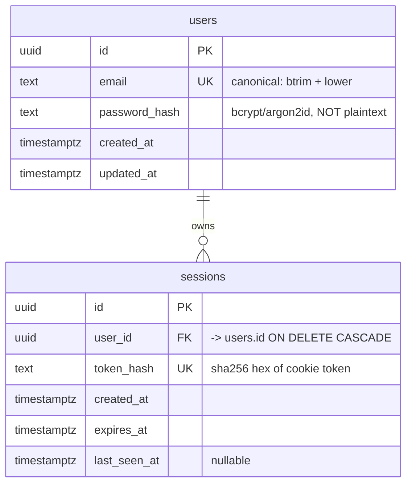

# Auth — Data model

**Status:** draft for review
**Date:** 2026-10-23
**Database:** PostgreSQL 15+
**Domain:** auth (`users`, `sessions`)
**Owned by:** `spec/features/auth/register.design.md`, `spec/features/auth/login-logout.design.md`
**Backing rules:** `spec/domains/auth/requirements.md` (REQ-001 … REQ-012)

This is the canonical model for the auth domain. Feature designs reference it
instead of restating the schema; a feature that changes the model updates this
file.

## Principles

1. **Passwords are stored hashed, never in plain text** (REQ-001). Only a slow
   hash (bcrypt cost ≥ 12 or argon2id) is persisted; the plaintext lives only
   in the request and the hash call. No endpoint ever selects `password_hash`
   into a response.
2. **Emails are stored and compared case-insensitively** (REQ-007). Every email
   that enters the system is canonicalized once — `btrim` then `lower` — and
   only the canonical form is stored. Lookups use the canonical form, so
   `"Reader@Example.com"` and `"reader@example.com"` are one account and a
   different casing at registration hits the unique constraint. A `CHECK`
   enforces the canonical form at the database boundary, so a bug that skips
   normalization fails loudly instead of creating a near-duplicate. (Trimming
   is the design's normalization choice; REQ-007 mandates the case folding.)
3. **Session tokens are opaque and hashed at rest.** The cookie carries a
   random token; the database stores only its SHA-256 digest. A database leak
   does not yield usable sessions.
4. **Uniqueness is enforced by the database**, not by check-then-insert in the
   application, so concurrent requests cannot violate REQ-002/REQ-007.

## Entity-relationship overview



## `users`

One row per account (REQ-001).

| Column | Type | Null | Default | Notes |
|---|---|---|---|---|
| `id` | `uuid` | no | `gen_random_uuid()` | Primary key. Never exposed as a session credential; safe to return to its owner. |
| `email` | `text` | no | — | Canonical form only: trimmed and lowercased. Unique. |
| `password_hash` | `text` | no | — | bcrypt cost 12 (`$2b$12$…`) or argon2id (`$argon2id$…`). Never returned by the API, never logged. |
| `created_at` | `timestamptz` | no | `now()` | UTC. |
| `updated_at` | `timestamptz` | no | `now()` | Maintained by trigger `users_set_updated_at` on `UPDATE`. |

Constraints:

```sql
CREATE TABLE users (
  id            uuid        PRIMARY KEY DEFAULT gen_random_uuid(),
  email         text        NOT NULL,
  password_hash text        NOT NULL,
  created_at    timestamptz NOT NULL DEFAULT now(),
  updated_at    timestamptz NOT NULL DEFAULT now(),
  CONSTRAINT users_email_key        UNIQUE (email),
  CONSTRAINT users_email_canonical  CHECK (email = lower(btrim(email))),
  CONSTRAINT users_email_not_blank  CHECK (length(email) > 0),
  CONSTRAINT users_email_has_at     CHECK (position('@' IN email) > 1),
  CONSTRAINT users_password_hash_present CHECK (length(password_hash) > 0)
);
-- users_email_key is created by the UNIQUE constraint above; no second index.
```

Indexes:

| Index | Definition | Serves |
|---|---|---|
| `users_email_key` | `UNIQUE (email)` | Registration duplicate detection (REQ-002, REQ-007); login lookup (REQ-008). One index does both. |

Notes:

- The `UNIQUE` index is the sole authority for "exactly one account per email"
  (REQ-002). The API translates SQLSTATE `23505` into `409 email_taken`.
- Because storage is lowercase, a differently-cased registration collides on
  this index — the direct implementation of REQ-007's registration bullet.
- `length(password_hash) > 0` is a cheap guard; the real invariant is "hash, not
  plaintext", which the application enforces and tests assert.
- Email format is validated in the application (REQ-003); the DB checks are
  last-resort guards, not the user-facing validation.
- `updated_at` is not used by any scenario; it exists for operability.

## `sessions`

One row per active signed-in session (REQ-008, REQ-011).

| Column | Type | Null | Default | Notes |
|---|---|---|---|---|
| `id` | `uuid` | no | `gen_random_uuid()` | Primary key; internal only. |
| `user_id` | `uuid` | no | — | FK → `users.id`, `ON DELETE CASCADE`. |
| `token_hash` | `text` | no | — | SHA-256 hex (64 chars) of the cookie token. Unique. The raw token is never stored. |
| `created_at` | `timestamptz` | no | `now()` | Login time. |
| `expires_at` | `timestamptz` | no | — | `now() + interval '7 days'`; must equal the cookie `Max-Age`. |
| `last_seen_at` | `timestamptz` | yes | `NULL` | Optional touch on authenticated requests; unused by design tests. |

Constraints and indexes:

```sql
CREATE TABLE sessions (
  id           uuid        PRIMARY KEY DEFAULT gen_random_uuid(),
  user_id      uuid        NOT NULL REFERENCES users(id) ON DELETE CASCADE,
  token_hash   text        NOT NULL,
  created_at   timestamptz NOT NULL DEFAULT now(),
  expires_at   timestamptz NOT NULL,
  last_seen_at timestamptz,
  CONSTRAINT sessions_token_hash_key UNIQUE (token_hash),
  CONSTRAINT sessions_token_hash_len CHECK (length(token_hash) = 64),
  CONSTRAINT sessions_expiry_after_creation CHECK (expires_at > created_at)
);

CREATE INDEX sessions_user_id_idx    ON sessions (user_id);
CREATE INDEX sessions_expires_at_idx ON sessions (expires_at);
```

| Index | Serves |
|---|---|
| `sessions_token_hash_key` | Every authenticated request resolves the cookie in one lookup; logout `DELETE … WHERE token_hash = $1`. |
| `sessions_user_id_idx` | FK verification, future "log out all devices", user deletion. |
| `sessions_expires_at_idx` | Periodic purge of expired rows (`DELETE FROM sessions WHERE expires_at < now()`). |

Notes:

- **Logout** is `DELETE FROM sessions WHERE token_hash = $1`. Zero rows affected
  is not an error (REQ-012) — the endpoint returns `204` either way.
- **Expiry** is checked in the API on every authenticated request. An expired
  row behaves like a missing one (401 on `/me`, 204 on logout) and is not
  necessarily deleted inline.
- **Revocation scope:** logout removes only the presented session; other devices
  stay signed in. No rule specifies multi-device behaviour, so this is the
  conservative reading of REQ-011.
- `ON DELETE CASCADE` guarantees no orphan sessions if an account is removed
  (deletion is not in scope yet, but the model stays consistent).

## Write/read paths (summary)

| Operation | Tables | Statement shape |
|---|---|---|
| Register | `users` | `INSERT … (email, password_hash) VALUES ($canonical, $hash)` → `23505` = duplicate |
| Login | `users`, `sessions` | `SELECT id, email, password_hash WHERE email = $canonical`; on match `INSERT INTO sessions (user_id, token_hash, expires_at)` |
| Authenticate | `sessions`, `users` | `JOIN users ON … WHERE token_hash = $1 AND expires_at > now()` |
| Logout | `sessions` | `DELETE WHERE token_hash = $1` (0 or 1 rows, no error) |
| Current user | `users` | via the session join; never returns `password_hash` |

## Canonicalization and hashing parameters

| Concern | Rule | Design |
|---|---|---|
| Email case | REQ-007 | `email_norm = btrim(raw).toLowerCase()`; validated after trimming; stored as `email_norm` |
| Missing vs whitespace email | REQ-003/REQ-005 | `undefined`/`null`/`""` → *required*; non-empty but blank after trim → *invalid* |
| Password | REQ-001, REQ-004 | Never trimmed; min length 8 counted on the raw string; bcrypt cost 12 or argon2id with library defaults |
| Password comparison | REQ-008 | Constant-time verifier; dummy verify against a fixed hash for unknown emails (anti-enumeration, REQ-009/REQ-010) |
| Session token | REQ-008/REQ-011 | 32 random bytes (base64url) in the cookie; `sha256` hex in `token_hash` |
| Cookie | REQ-008 | `nt_session`; `HttpOnly; SameSite=Lax; Path=/; Secure` in production; `Max-Age=604800` |

## Migration order

1. `CREATE EXTENSION IF NOT EXISTS pgcrypto;` (for `gen_random_uuid()`; built in
   on PG13+, kept for portability).
2. `users` + `users_email_key`.
3. `users_set_updated_at` trigger.
4. `sessions` + its three indexes.

Migrations are forward-only and idempotent (`IF NOT EXISTS` where supported).

## Forward reference — novels domain

The novels model (not yet designed) will own `novels.user_id uuid NOT NULL
REFERENCES users(id) ON DELETE CASCADE` to enforce per-user isolation
(REQ-026/REQ-030/REQ-033 of the novels domain). Nothing in the auth model
depends on novels; this note only fixes the direction of the future FK so the
two models do not diverge.

## Invariants worth testing

| Invariant | Rule | Check |
|---|---|---|
| No plaintext password in `users` | REQ-001 | Stored value matches the hash format and verifies against the submitted password; is not equal to it |
| One account per canonical email | REQ-002, REQ-007 | `UNIQUE`; second registration → `409`, row count unchanged |
| Emails stored lowercase | REQ-007 | `SELECT count(*) FROM users WHERE email <> lower(email)` is 0 |
| No raw token in `sessions` | REQ-008 | `token_hash <> cookie value` and matches `sha256(cookie value)` |
| Logout leaves no row | REQ-011 | Session count for the user drops by exactly one |
| Logout is idempotent | REQ-012 | Second logout → `204`, zero rows changed, no error |

## Change log

| Date | Change | Feature |
|---|---|---|
| 2026-10-23 | Initial model: `users`, `sessions`; canonical email + unique index; hashed passwords and token digests | register, login-logout |
